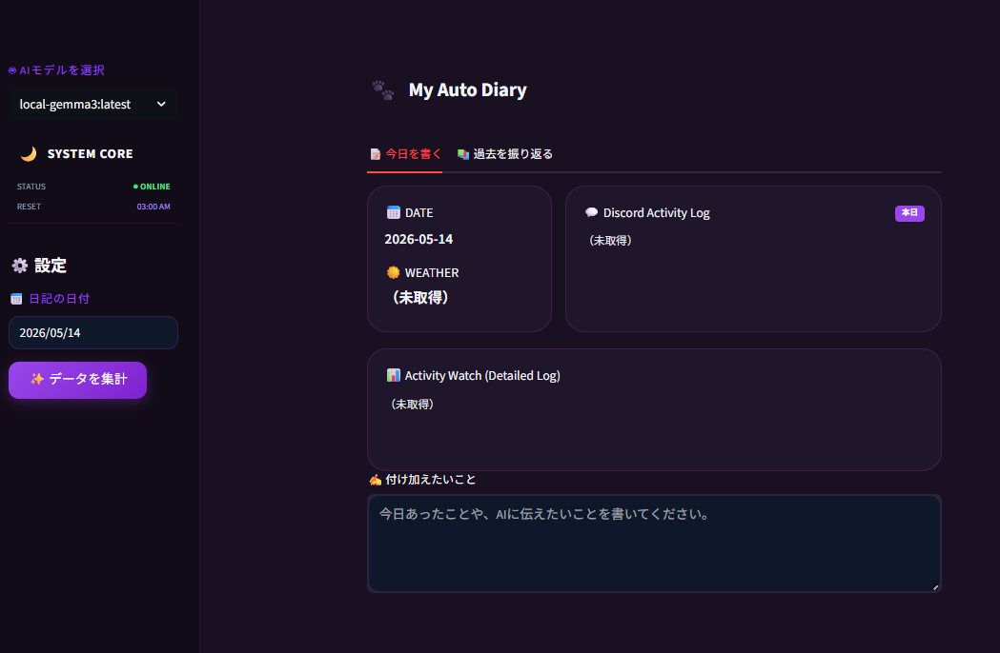

# MyWeeklyDiary 🌙🐾

ActivityWatch のログと Discord のつぶやきを統合し、AI が 1 日の日記を自動生成するプライバシー重視型の日記作成ツールです。

## 特徴

*  [Open-Meteo API] を利用して、指定した日付の天気と気温を自動取得。
* **ログ自動集計**: ActivityWatchでPC操作時間、Discordから日々のつぶやきを取得。
* **プライバシー保護**: 特定アプリやメアドを自動で匿名化。さらに、AIへ送信する前に画面上でログを直接手動で編集・削除できます。
* **AI自動執筆**: ログと天候データを統合し、Geminiが自然な一人称の日記を作成。
* **夜更かし対応**: 午前3時までの活動は「前日の日記」として扱います。
* **1週間の記憶（週次アーカイブ）**: 今日までの過去 7 日分の日記要約を「記憶」として AI が参照します。 これにより、「昨日の続きの作業」や「数日前から考えていたこと」など、日々の文脈を汲み取った深みのある日記を生成できます。また、毎週日曜日、1週間を振り返る総括レポートを自動生成。週の進捗や感情の変化を俯瞰できます。
* **選べるAIエンジン**: 日記生成にローカルLLMモデルを使うか、APIを使うか選べます。


## 技術スタック
* **Language**: Python 3.14+
* **Package Manager**: [uv](https://github.com/astral-sh/uv) 
* **Web UI**: [Streamlit](https://streamlit.io/) 
* **AI Engine**:
    * [Gemini API](https://aistudio.google.com/)
    * [Local: Ollama](https://ollama.com/)
* **Data Sources**:
    * [ActivityWatch](https://activitywatch.net/) (ローカル活動ログ)
    * [Discord API](https://discord.com/developers/docs/intro) (感情/思考ログ)
    * [Open-Meteo](https://open-meteo.com/) (気象データ)

## API料金とプライバシーについて
* **無料運用が可能**: Gemini API（Google AI Studio）の無料ティアの範囲内で運用可能です（1日の終わりに1回～数回程度の実行を想定）。
* **プライバシーの注意**: Google AI Studioの無料枠のAPIはGoogleの学習に利用される可能性があります。Google AI Studioを使う場合は、絶対に外部に漏らしたくない機密情報等は、送信前の画面でログから削除してください。
* **人名の扱い**: ウィンドウのタイトル（ファイル名など）やDiscordのつぶやきに含まれる人名も、そのままAIに送信されます。Gemini APIを使う場合は、名字やフルネームではなく、あだ名や下の名前で書く習慣をおすすめします。特に珍しい名字は、それだけで本人の特定につながることがあります。気になる場合は、送信前の画面で書き換えるか、ローカルLLMを選んでください。

## セットアップ

> [!IMPORTANT]
> **本ツールの実行には [ActivityWatch](https://activitywatch.net/) がバックグラウンドで起動している必要があります。**
> 起動していない場合、データの集計時にエラーが発生します。

> [!CAUTION]
> **`.env` ファイルは絶対に GitHub 等に公開しないでください。**
> あなたの Gemini API キーが盗まれ、悪用される危険があります。

**【必要なもの】**
* [uv](https://github.com/astral-sh/uv) (Pythonパッケージマネージャー)
* [ActivityWatch](https://activitywatch.net/) (ローカルで起動しておく)
* [Ollama](https://ollama.com/) (ローカルLLMを使用する場合。インストール後、使用するモデルを pull しておく必要があります。例: `ollama pull gemma4`)
* *(任意)* Gemini APIキー ([Google AI Studio](https://aistudio.google.com/) から取得。ローカルLLMだけを使う場合は必要ありません)
* *(任意)* Discord Botトークン & チャンネルID

**【インストールと設定】**
```bash
git clone https://github.com/Chizrosa/MyWeeklyDiary.git
cd MyWeeklyDiary
uv sync
cp .env.example .env
```
作成された `.env` ファイルに、取得したAPIキー等を設定してください。（※`.env`は絶対に公開しないでください）

天気の取得場所 `CITY_NAME` と、1日の区切りに使うタイムゾーン `TIMEZONE` も、お住まいの地域に合わせて設定してください（例: `CITY_NAME=Siracusa` / `TIMEZONE=Europe/Rome`）。未設定の場合は東京の天気・UTC時刻で集計されます。

**Discord連携を行う場合 (任意)**
1. [Developer Portal](https://discord.com/developers/applications) でBotを作成しトークンを取得。
2. Botを自分用の非公開サーバーに招待。
3. Discordの「詳細設定 ＞ 開発者モード」をオンにし、対象チャンネルを右クリックしてIDをコピー。
4. `.env` の `DISCORD_TOKEN` と `DISCORD_CHANNEL_ID` にトークンとIDを追記します。

※ 指定した日のメッセージだけを、その日の午前3時から順に取得します（1日あたり最大1000件まで）。

## 使い方

1. Ollama の起動: ローカルモデルを使う場合は、ollama serve を実行。

2. 以下のコマンド（または`WeeklyDiary.bat`の実行）で起動します。
```bash
uv run streamlit run main.py
```
<br>
<div align="center">
  
</div>
<br>

> [!IMPORTANT]
> **WeeklyDiary.bat を実行して開いた黒い画面（コマンドプロンプト）は、アプリのサーバーです。ブラウザを使っている間は、この画面を閉じないでください。 閉じるとアプリも終了してしまいます**

1. 日付を選び **「データを集計」** をクリック。
2. プレビューを確認し、AIに見られたくないログがあればここで直接削除・修正します。
3. **「付け加えたいこと」** の入力欄に、ログには残っていないその日の出来事や感情があればメモします（※ここに書いた内容もAIに送信され、日記に反映されます）。
4. AI モデルの選択 (サイドバー):高性能な gemini-... モデルか、プライバシー重視の local-... (Ollama) モデルか、その時の気分で選択できます。
5. **「AIに日記を書いてもらう」** で日記を生成。このとき、AI は自動的に過去 7 日間の日記要約（記憶）を読み込みます。 これにより、「昨日から続いている作業」などの文脈を反映した執筆が行われます。
6. **「ファイルに保存する」** でMarkdown形式で保存されます。
   * (ファイル下部には、AI に送らなかったデータも含めた「生ログ全件」がローカル専用の記録として残ります)
   * 保存された日記は memory_db.json に蓄積され、明日以降の日記生成に活用されます。

## 📁 フォルダ構成

```text
MyWeeklyDiary/
├── main.py            # メインプログラム（AI モデルの切り替えや集計ロジック）
├── ui_parts.py        # 画面の UI コンポーネント（ログ編集エリアなど）
├── prompt.txt         # Gemini API 用の指示書
├── prompt_local.txt   # ローカル LLM (Ollama) 用の指示書（モデル特性に合わせて調整済み）
├── memory_db.json     # AI 参照用の記憶データベース（過去 7 日分の要約を保持）
├── 1行日記まとめ.md    # 【おまけ】人間用の 1 行日記一覧。保存先フォルダに自動で作成・更新されます
├── WeeklyDiary.bat  # Windows 用の一発起動ショートカット
├── .env               # API キーや保存先パスの設定（GitHub 非公開）
└── README.md          # この説明書
```

## カスタマイズ（自分好みに調整する）

このツールは、ご自身の環境や好みに合わせて自由にカスタマイズ可能です。

* **プロンプトの変更 (`prompt.txt`)**: 
  AIの口調、日記の文字数、重視してほしいポイントを変えたい場合は、このテキストファイルを編集してください。
    * prompt.txt: Gemini API 用。
    * prompt_local.txt: ローカル LLM 用。 モデル（Llama や Gemma）の特性に合わせて、より詳細な指示を書き込むことができます。
* **使用するAIモデルの変更 (`main.py`)**: 
  MODEL_OPTIONS リストを書き換えることで、サイドバーの選択肢を増やせます。
    * Gemini API: gemini-3.8-flash などの公式モデル名を記述します（終了予定のモデルは [Gemini deprecations](https://ai.google.dev/gemini-api/docs/deprecations) で確認できます）。
    * Local LLM: Ollama にインストールしたモデル名の冒頭に local- を付けて記述します（例: local-gemma4:latest）。
* **プライバシーフィルターの育成 (`main.py`)**: 
  「このアプリ名も匿名化したい」「このキーワードは無視してほしい」という場合は、コード内のフィルター用リストや条件に単語を書き足すことで、自分専用にフィルターをカスタマイズしてください。
  伏せ字のラベル（`SENSITIVE_APPS` の右側の言葉）は、自分の状況に合わせて書き換えると日記の精度が上がります。例えば講師としてTeamsで授業をしている場合は `"ms-teams.exe": "オンラインレッスン（講師として）"` のようにすると、中身は隠したまま、AIに必要な文脈だけを伝えられます。
* **ローカルモデルの安定化 (`main.py`)**:
  お使いの PC スペックに合わせて、num_ctx（コンテキスト長）や num_gpu（GPU レイヤー数）などのパラメータを微調整することで、生成速度や安定性を最適化できます。

## 拡張例・応用例

このツールは、Discord に送信されたデータであれば柔軟に対応できます。
ユーザーが工夫次第で、以下のような情報も日記に統合できます：

* **iPhone ショートカット** - 歩数、ワークアウト、移動距離などのヘルスデータ
* **ゲーム監視** - Steam や各ゲームプラットフォームのプレイ時間・成績
* **IoT デバイス** - 睡眠データ、体温計、スマートホーム連携
* **外部 API** - GitHub コントリビューション、Spotify の再生履歴など

**コツ**: Discord に投稿されたメッセージなら、ActivityWatch とは無関係に AI に送信され、日記に反映されます。

### 実装例
- iPhone のショートカットで毎日の歩数を Discord に送信 → 翌日の日記に「○○歩歩きました」と自動反映
- PCゲームのプレイログを監視ツールで Discord に飛ばす → 「今日は○○をプレイしました」と統合

## Obsidianユーザーの方へ
`.env` ファイル内の `SAVE_DIR` をご自身のVault（保管庫）の絶対パスに変更すると、直接Obsidian内に日記が保存されるようになります。（重要キーワードは自動で [[ ]] リンク化されます。不要な場合は`prompt.txt`を編集してください。）

## 免責事項
本ツールは個人開発のプロジェクトです。AIの性質上、事実と異なる内容が生成される可能性があります。万が一のデータ消失やAPIの意図せぬ課金等について開発者は責任を負いかねますので、適宜バックアップを取り、自己責任の範囲でご活用ください。

## ライセンス / 開発について
* This project is licensed under the MIT License.
* コードの大部分は、AIアシスタント（Gemini）とのペアプログラミングによって作成されました。
* 2026年10月の見直し（モデルの更新、天気・Discordの取得の改善、プロンプトの調整など）は、[Claude](https://claude.com/)（Anthropic）と一緒に行いました。
